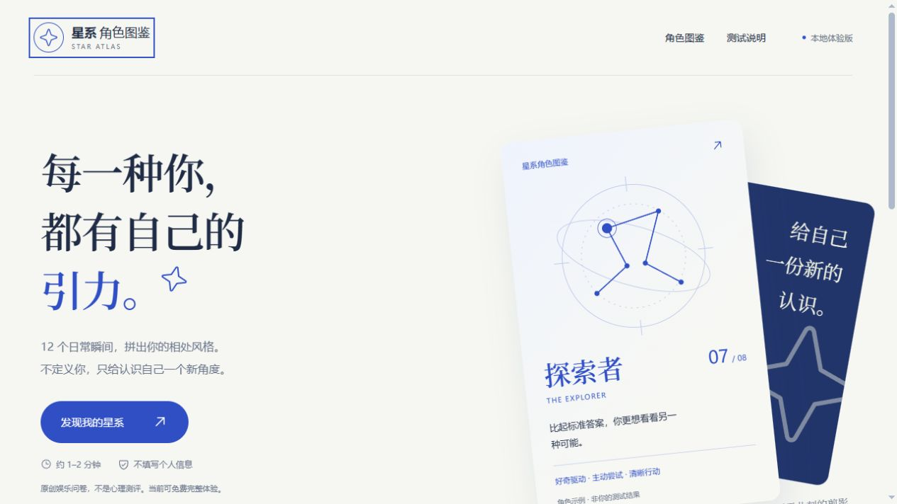

# 星系角色图鉴

<p align="center">
  
</p>

# 星系角色图鉴 · STAR ATLAS


原创娱乐问卷的本地 H5 原型。12 道题、8 种角色、明确标识的免费演示解锁，以及本机生成的高清结果卡。

**在线体验（GitHub Pages）**：`https://guoba371.github.io/Ziwei/`（部署工作流推送 `main` 后自动生效）

## 运行

推荐 Node.js 24。首次运行安装锁定版本的依赖：

```powershell
npm ci
npm run dev -- --port 5173 --strictPort
```

打开 http://127.0.0.1:5173/ 。服务仅监听本机，不是公网地址；关闭终端或停止服务后需要重新启动。

```powershell
npm test
npm run typecheck
npm run build
npm run preview -- --port 4173 --strictPort
```

`dist/` 是构建后的静态站点。不要双击 `index.html`，使用 HTTP 服务预览。

## 部署到 GitHub Pages

仓库内含 `.github/workflows/deploy-pages.yml`：推送到 `main` 时自动构建并发布到 Pages。首次启用需在 GitHub 仓库 **Settings → Pages → Build and deployment → Source** 选择 **GitHub Actions**。

## 已实现

- 12 道中文原创情境题，单选、进度、键盘操作、返回修改和重新开始。
- 八角色目录和就地详情预览、三维度确定性评分、角色短句与四段完整内容。
- 免费结果与明确标记的演示解锁；没有支付成功或真实订单提示。
- 1080 × 1440 PNG 下载和移动端长按保存预览，包含娱乐说明。
- 桌面和移动端布局、本地子集字体、系统深色模式、减少动态效果支持。

## 规则与数据

每个维度四题，各选项 0–3 分；总分 0–12，>= 6 为右侧倾向。三个维度的八种组合映射为八个原创角色。它是内容分类规则，没有科学量表的效度验证，也不是运势、健康、关系或能力评估。

答案只放在当前页面的 React 内存，不写入 Cookie、localStorage 或服务端。刷新会清空。字体、图标与所有内容在本地构建，没有外部 API 或统计 SDK。导出图片不包含原始答案。

## 不是商业成品

- “拟售 ¥2.9”仅为价格假设，原型完全免费。
- 演示解锁不是安全访问控制，全部内容都在前端包中；不能直接用作收费系统。
- 没有账号、支付、订单、退款、平台自动发货或真正的分享回流归因。
- 未连接 ziwei-doushu 仓库，未使用其数据集、倪师原话或生日排盘逻辑。
- 平台类目、外链、履约和售后规则尚未核实，不代表已经可以在小红书上架。

## 文件导航

- `src/quiz.ts`：题目、角色内容、评分规则。
- `src/App.tsx`：首页、答题流程。
- `src/components/Result.tsx`：结果、演示解锁、图片预览生命周期。
- `src/export-card.ts`：浏览器 Canvas 导出。
- `src/styles.css`：响应式视觉样式。
- `docs/prd/01-紫微人格图鉴.md`：当前获批 PRD，保留旧文件名便于引用。
- `PRODUCT.md`、`DESIGN.md`：产品边界和视觉约定。

## 验证范围

单元与组件测试覆盖八角色可达、分界值、无效答案、往返修改、模拟解锁、清空重测、键盘操作、不上传与不持久化、图片导出失败路径。Canvas 在 jsdom 中使用绘图边界替身；真实图片渲染与下载另外通过浏览器验证，不由替身测试证明。

本地 Chromium 桌面和手机视口已检查；未使用真实 iPhone、Android 或小红书内置 WebView 验证。兼容性与真实交易链路需要在上线阶段另行验证。

2026-10-24 UI 优化验证：32 项自动测试、TypeScript 检查和生产构建通过。新增目录就地预览和键盘焦点保持测试。浅色/深色模式下检查 320、360、390、768、1024、1440px 视口，均无水平溢出，首屏标题两行且主按钮可见。浏览器走通键盘答题、返回保留答案、完整结果、明确解锁、1080 × 1440 图片生成和刷新清空。

移动模拟 Lighthouse：性能 94、可访问性 100、最佳实践 100、SEO 91；FCP 1.4s、LCP 3.0s、CLS 0、TBT 0ms。首屏中文字体从约 20 个分片合并为单份 292.6 KB 子集，并在 `index.html` 预加载；字体仅覆盖当前文案用到的字符，弱网首屏明显改善。剩余 LCP 受 Lighthouse 模拟的本地固定等待时长影响，实际生产环境需用真实部署和 CDN 复核。首页和结果页的渐变文字仍需人工补查对比度，自动审计不等于完整无障碍认证。

本轮自动浏览器实际下载被取消，已确认图片生成及预览尺寸，但未据此声称本轮下载验证通过；下载与真实手机长按保存仍需实际浏览器复核。导出逻辑未改动。此前版本的真实 PNG 下载及依赖审计曾通过，不作为本轮复核结果。

截图、布局/对比度记录及 Lighthouse 报告位于 `artifacts/ui-*`。系统深色模式不会修改结果 PNG 的浅纸色风格，也不会新增浏览器存储。

## 第三方素材

自托管 Noto Serif SC 字体与 Phosphor 图标的许可、React 许可随构建一并放在 `public/licenses/`。几何星轨坐标、问卷和角色文案在本项目中编写，没有复用原紫微数据集内容。
